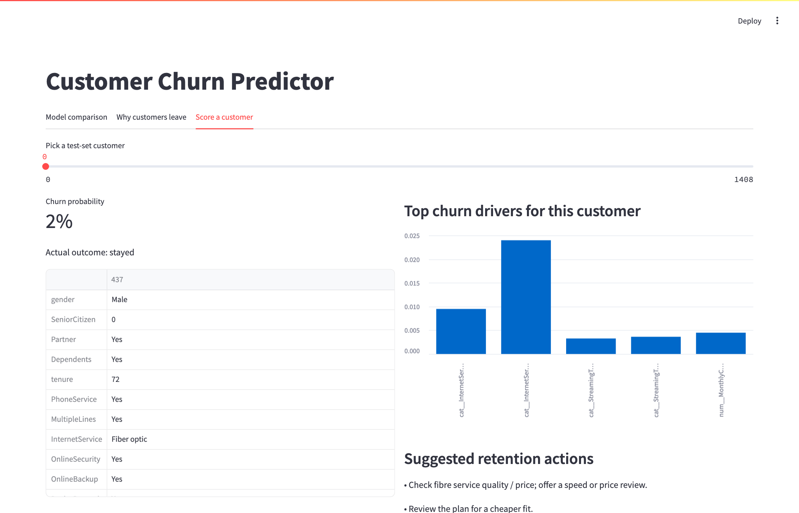
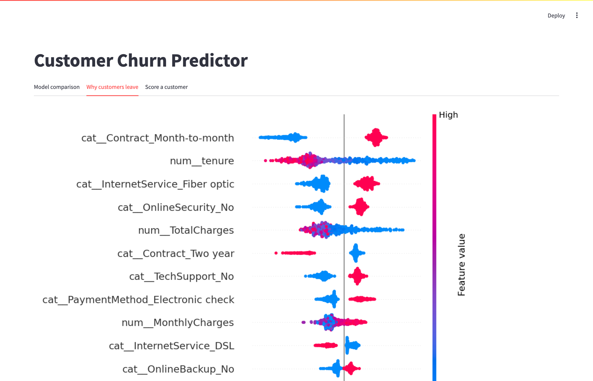

# Customer Churn Predictor

Predicts which telecom customers are likely to cancel, explains why, and suggests what to do about it. The Streamlit app lets you pick a customer, see their churn probability, and read the top reasons the model gave.



## Problem

Winning back a customer who has already left costs more than keeping one who is thinking about it. The goal is to rank customers by churn risk so a retention team can contact the right ones first. A missed leaver costs more than an unneeded discount, so recall matters more than precision here.

## Data

IBM's Telco Customer Churn sample: 7,043 customers, 20 features covering contract, services, billing and tenure. About 27% churned. The file is in `data/telco.csv`. The 11 blank `TotalCharges` values belong to customers with zero tenure, so they are set to 0.

## Approach

1. Clean the data, one-hot encode categoricals and scale numeric columns.
2. Split 80/20 with stratification so both sets keep the 27% churn rate.
3. Train Logistic Regression and Random Forest, both with balanced class weights.
4. Compare precision, recall, F1 and ROC-AUC on the held-out set.
5. Explain the best model with SHAP and map the top drivers to retention actions in the app.

## Results

Held-out test set, 1,409 customers.

| Model | Precision | Recall | F1 | ROC-AUC |
|---|---|---|---|---|
| Logistic Regression | 0.504 | 0.783 | 0.614 | 0.842 |
| Random Forest | 0.550 | 0.746 | 0.633 | 0.842 |

Random Forest wins on F1, so the app uses it. Logistic Regression catches slightly more leavers (higher recall) but flags more people who would have stayed.

The strongest churn drivers, by mean absolute SHAP value, are a month-to-month contract, short tenure, fibre internet, no online security and no tech support. In the raw data, 43% of month-to-month customers churned, against 11% on one-year and 2.8% on two-year contracts.



## Run it

```
pip install -r requirements.txt
python train.py
streamlit run app.py
```

`train.py` writes `model.joblib`, `metrics.json` and `shap_summary.png`, which the app reads.

## Limitations

- One train/test split, no cross-validation and no hyperparameter tuning.
- The retention suggestions in the app are hand-written rules keyed to SHAP drivers. Nobody has tested whether they reduce churn.
- The 0.5 decision threshold is the default. A real team would pick it from the cost of an offer versus the cost of a lost customer.

## Stack

Python, pandas, scikit-learn, SHAP, matplotlib, Streamlit.
